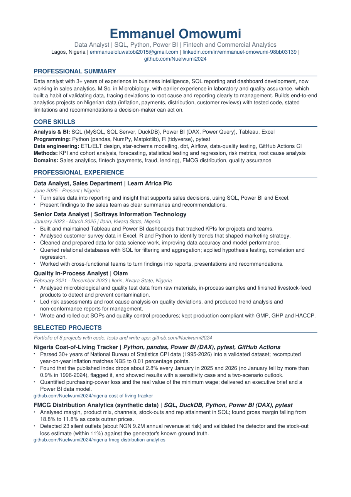
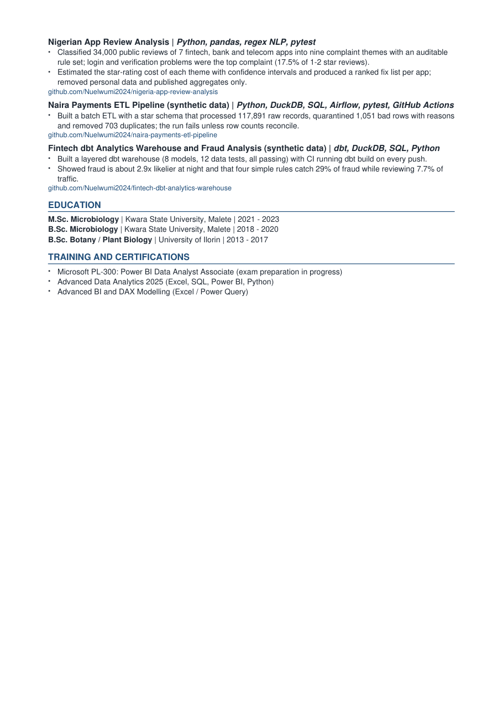

# Emmanuel Omowumi: Data Analyst CV

Two-page, single-column CV for Data Analyst and Business Intelligence roles in Nigeria and remote.

| Format | File |
|---|---|
| PDF (send this one) | [Emmanuel_Omowumi_Data_Analyst_CV.pdf](Emmanuel_Omowumi_Data_Analyst_CV.pdf) |
| Word (editable, for application portals that ask for .docx) | [Emmanuel_Omowumi_Data_Analyst_CV.docx](Emmanuel_Omowumi_Data_Analyst_CV.docx) |

| Page 1 | Page 2 |
|---|---|
|  |  |

## Why it is built this way

- **ATS-friendly:** one column, standard headings (Professional Summary, Core Skills, Professional Experience, Education), real text and no images, tables or text boxes, so applicant-tracking systems read it correctly.
- **A4**, 2 pages, plain fonts, links that work.
- **Evidence over adjectives:** project bullets give numbers and link to the code, tests and write-ups.
- **Honest about data:** projects that use synthetic data say so on the CV.

## Edit and rebuild

All content lives in [`src/cv_content.py`](src/cv_content.py); layout is in [`src/build_cv.py`](src/build_cv.py). Both files are generated from the same content, so the PDF and Word versions always match.

```bash
pip install python-docx reportlab
python src/build_cv.py
```

## Before you send it

- Add one or two **measurable results** to each job (for example report turnaround time, number of dashboards, users served, decisions supported). Recruiters look for numbers, and the job bullets currently describe duties.
- Add a **phone number** to the contact line if you want recruiters to call.
- Tailor the **professional summary** and the order of the project bullets to each job advert (copy keywords from the advert where they are true).
- Update the **PL-300** line when you pass the exam.
